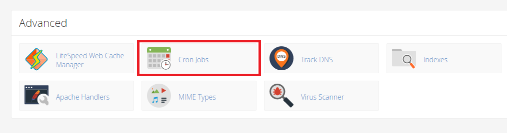

MagicPost runs all of its background work from the Laravel scheduler. A single cron job that starts the scheduler every minute is enough to publish posts, renew channel tokens, deliver webhooks, read feeds and more. If it does not run, scheduled posts simply stop going out.

<Warning>
Without the cron job nothing is published. Add it as soon as the install finishes.
</Warning>

## The cron command

MagicPost builds the exact command for your server, with the application path and the PHP binary it found. You can copy it from two places:

- The last screen of the [web installer](/installation/web-installer), under **One last step: add the cron job**.
- Admin → Publishing → Settings, in the **Sending** card, next to **Cron job**. Click **Copy** for the command alone, or **Copy the crontab line** for the full line.

The crontab line looks like this. Your path and PHP binary will differ, so copy yours from the application.

```bash
* * * * * cd /home/USERNAME/public_html && /usr/local/bin/php artisan schedule:run >> /dev/null 2>&1
```

<Note>
Under PHP-FPM or LiteSpeed the web server's PHP is not the command-line PHP. MagicPost uses the command-line `php` from the same PHP installation when it can find one, and plain `php` otherwise. If the command it shows does not run, ask your host for the path of the command-line PHP and use that instead.
</Note>

## Add the cron job

<Tabs>
  <Tab title="cPanel">
    <Steps>
      <Step title="Open Cron Jobs">
        In cPanel, open **Cron Jobs** in the **Advanced** section.

        <Frame caption="Cron Jobs in the Advanced section of cPanel">
          
        </Frame>
      </Step>
      <Step title="Choose the interval">
        Under **Add New Cron Job**, open **Common Settings** and choose **Once Per Minute**. If your cPanel has no such option, type `*` in each of the **Minute**, **Hour**, **Day**, **Month** and **Weekday** fields.
      </Step>
      <Step title="Paste the command">
        Paste the command from MagicPost into the **Command** field and click **Add New Cron Job**.
      </Step>
    </Steps>
  </Tab>
  <Tab title="Crontab on a VPS">
    Run `crontab -e` as the user that owns the application files, paste the full crontab line from the **Sending** card, and save.
  </Tab>
</Tabs>

<Tip>
If your host only allows a five-minute interval, the cron job still works, but posts go out up to five minutes late. **System health** treats the cron job as stopped when the last run is more than five minutes old, so with a five-minute interval it can flag the job between runs.
</Tip>

## What the scheduler runs

Every task runs inside the `schedule:run` process, so the scheduler does not need `proc_open`. Tasks that overlap themselves are guarded with cache locks, which is why **System health** warns when `CACHE_STORE` is `array` or `null`.

| Task | When | What it does |
|---|---|---|
| `publishing:heartbeat` | Every minute | Records the time of the run. **System health** reads it for the **Cron job** line. |
| `publishing:dispatch` | Every minute | Claims posts that are due and queues them. It also closes off posts that can never go out and posts held back longer than **Wait for a channel for up to**. |
| `publishing:work:1`, `publishing:work:2` | Every minute, in scheduler mode only | Two lanes that send queued jobs, so one long upload does not stall every other post. |
| `publishing:deliver-webhooks` | Every minute | Sends webhook deliveries that are due and clears out old ones. |
| `telegram:poll` | Every minute, only while Telegram is set to polling | Fetches waiting Telegram updates for a site that Telegram cannot reach with a webhook. See [Set up Telegram](/channels/telegram/setup). |
| `publishing:recover` | Every 5 minutes | Returns posts that were left in the sending state longer than **Pick up a stalled send after**. |
| `publishing:check-feeds` | Every 5 minutes | Reads the RSS feeds that are due and turns new articles into posts. |
| `media:sweep-generations` | Every 5 minutes | Picks up AI image and video requests that a crashed run left behind, and releases the credits of requests that never finished. |
| `publishing:recurring` | Hourly | Creates the upcoming occurrences of recurring posts. |
| `publishing:refresh-tokens` | Hourly | Renews channel access tokens that expire within 24 hours. |
| `publishing:sync-metrics` | Hourly, only while **Collect analytics** is on | Reads follower and post figures from the networks. |
| `publishing:recycle-evergreen` | Hourly, at 20 minutes past | Lines up the next repeat of every evergreen post that is due one. |
| `publishing:check-channels` | Hourly, at 30 minutes past | Checks channels that have posts due in the next two days, so a revoked token is found before a post fails. |
| `whatsapp:close-abandoned` | Hourly | Ends WhatsApp linking sessions that nobody finished. |
| `credits:release-expired-holds` | Hourly, at 45 minutes past | Releases credit holds that passed their expiry. |
| `credits:refresh-allowances` | Hourly, at 50 minutes past | Refreshes the monthly allowance of yearly and lifetime plans and ends unlimited credits whose plan has lapsed. |
| `publishing:prune-notifications` | Daily at 03:15, only while **Keep read notifications** is not set to **For good** | Deletes read publishing notifications older than the retention you chose. Unread ones are kept. |

## Cron mode and worker mode

Under Admin → Publishing → Settings, the **Sending** card has a **Posts are sent by** choice.

<Tabs>
  <Tab title="The scheduler">
    The default, for hosts that only offer cron. Every minute, the two `publishing:work` lanes process queued jobs for the number of seconds set in **Each pass sends for**. The value must be between 10 and 55 seconds, and the default is 45, so a pass ends before the next one begins. Lower it if your host stops long cron jobs.
  </Tab>
  <Tab title="A queue worker">
    For servers that keep a queue worker running under Supervisor or systemd. The scheduler stops running the `publishing:work` lanes, and you run this command from the folder MagicPost is installed in:

    ```bash
    php artisan queue:work --queue=publishing,default,media
    ```

    The cron job is still required in this mode, because the scheduler decides which posts are due and queues them.
  </Tab>
</Tabs>

Both modes use the queue named by `QUEUE_CONNECTION` in `.env`, which defaults to `database`. **System health** reports the `null` driver as a problem, because it throws jobs away, and the `sync` driver as a warning, because each post would then be sent inside the request that queued it. Set `QUEUE_CONNECTION=database` unless you run another queue backend on purpose.

**Hand out at most** on the same page limits how many posts are handed to the queue per minute. Posts due at the same moment beyond that limit go out over the following minutes. See [Publishing settings](/admin/publishing-settings) for the retry, waiting and upload limits.

## Check that it works

Open Admin → Publishing → Settings.

- The **Sending** card shows **Last ran** with the time of the last scheduler run, or **Has not run yet**.
- **System health** shows the **Cron job** line as passed, with the time of the last run. It fails with "The scheduler has never run" or "The scheduler last ran" when the last run is missing or more than five minutes old.
- The **Queue** line reports jobs that have waited more than ten minutes, and says whether the cause is a missing worker or a slow scheduler.
- Click **Check again** after you make a change.

## Troubleshooting

<AccordionGroup>
  <Accordion title="Has not run yet">
    The cron job is missing or its command is wrong. Check the path of the application and of the command-line PHP, and make sure the cron user can read the application folder.
  </Accordion>
  <Accordion title="The cron job runs but posts stay scheduled">
    Open **System health** and read the **Queue**, **Waiting posts** and **Stalled sends** lines. A channel that is paused, needs reconnecting, or belongs to a network that is switched off holds its due posts for up to the **Wait for a channel for up to** limit.
  </Accordion>
  <Accordion title="The Locks line warns about the cache">
    Set `CACHE_STORE=database` or `CACHE_STORE=file` in `.env`. The `array` and `null` stores forget everything between requests, so overlapping scheduler runs cannot be kept apart.
  </Accordion>
</AccordionGroup>

For more, see [Scheduler and queue problems](/troubleshooting/scheduler-and-queue).
